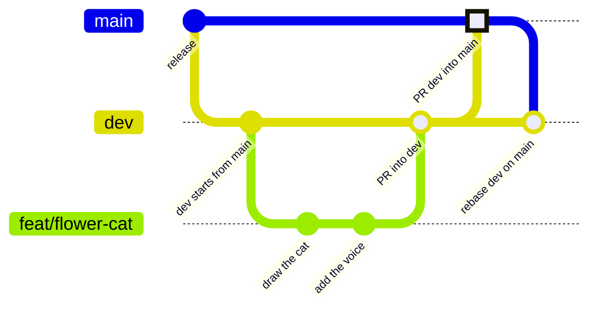
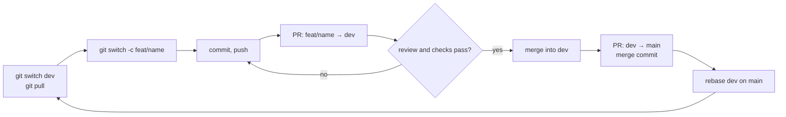

# Contributing to Bloom

## Branches

| Branch | What it holds | Who writes to it |
|---|---|---|
| `main` | what's released: the README, the site and the code people install | only pull requests from `dev` |
| `dev` | finished work waiting for the next release | pull requests from work branches, plus rebasing onto `main` |
| `feat/<name>` | a new feature | you |
| `bugs/<name>` | a bug fix | you |
| `optimize/<name>` | a speed-up or a smaller footprint | you |

Name a work branch after what it does, in a few words: `feat/flower-cat`, `bugs/music-clicks`, `optimize/whisper-threads`.

## The flow



The last step looks like a merge in the drawing, but it's a rebase: `dev` moves up to `main`'s commit (see step 4).



### 1. Start from `dev`

```sh
git switch dev
git pull --rebase origin dev
git switch -c feat/<name>
```

### 2. Open a pull request into `dev`

```sh
git push -u origin feat/<name>
gh pr create --base dev
```

Before you ask for a review, run the tests (`uv run python tests/test_bloom.py`). If `dev` moved while you worked, rebase your branch on it so the PR shows only your commits:

```sh
git fetch origin
git rebase origin/dev
git push --force-with-lease
```

### 3. Release: a pull request from `dev` into `main`

When `dev` holds what should go out, open a PR from `dev` into `main` and merge it with **Create a merge commit**. Don't squash or rebase it. The merge commit marks the release, and it keeps `main` and `dev` on the same commits. A PR into `main` from any other branch fails the `main-from-dev` check.

```sh
gh pr create --base main --head dev
gh pr merge --merge
```

### 4. Bring `dev` up to date with `main`

You can do this at any time, and always right after a release: rebase `dev` on `main`.

```sh
git switch dev
git fetch origin
git rebase origin/main
git push origin dev
```

Because `main` only receives `dev`, this is normally a fast-forward. `dev` moves up to `main`'s merge commit and no history changes. If the rebase rewrites commits (someone committed to `main` directly while `dev` had new work), the plain push is refused. Then push with `git push --force-with-lease origin dev` and tell everyone with a branch off `dev` to run `git rebase origin/dev` on it.

## Settings this relies on (GitHub, repository owner)

- Branch protection on `main`: require a pull request, and require the `main-from-dev / from-dev` status check.
- Branch protection on `dev`: require a pull request, but allow force pushes for maintainers so step 4 can rewrite `dev` when it has to.
- Allowed merge methods: keep **merge commits** enabled, because releases use them.

## Commits

Write the subject as a plain sentence about what changes for someone using Bloom ("Stop the generated music crackling"), not about the code. Keep one change per commit when you can.
