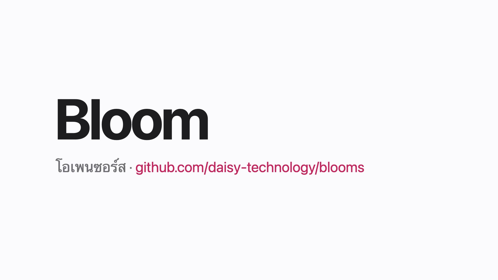

# Bloom

Turn a Thai voiceover script into a finished, animated short video. Part of the Daisy Technology family.

[](https://daisy-technology.github.io/blooms/#intro)

[Watch the 33-second intro](https://daisy-technology.github.io/blooms/#intro): Thai narration with subtitles, made with Bloom itself from [`scripts/intro`](scripts/intro). The site is at [daisy-technology.github.io/blooms](https://daisy-technology.github.io/blooms/).

You write two files: the narration (`script.md`) and the visuals as an animated web page (`scenes.html`). `bloom build` voices each scene, lays the clips on a timeline, writes subtitles, renders the page frame by frame in a headless browser, scores it with generated music and sound effects, and muxes it all into an MP4.

```
script.md ──► voice (OmniVoice / ElevenLabs / say) ──► timeline ──► subtitles (.srt)
scenes.html ─► render (Playwright → ffmpeg, picture only) ─┬─► sound-effect cues
                                                            ▼
             music (generated per scene mood) + voice + effects ─► mix (ducking, loudnorm) ─► output/<name>.mp4
```

Each scene lasts exactly as long as its voice clip plus a short pause, so picture and narration stay in sync without timing anything by hand.

Bloom also voices videos made elsewhere: `bloom dub` reads a video's captions and speaks each one as it appears (see Voice a video that already has captions).

## Set up

You need Python 3.10 or newer, [uv](https://docs.astral.sh/uv/), ffmpeg and git. Setup takes about 4 GB of disk, most of it PyTorch and the voice model.

**1. The tools.** Pick your system:

```sh
brew install uv ffmpeg git whisper-cpp                                     # macOS
winget install --id astral-sh.uv -e; winget install Gyan.FFmpeg Git.Git     # Windows (PowerShell), then open a new window
curl -LsSf https://astral.sh/uv/install.sh | sh && sudo apt install ffmpeg git   # Debian / Ubuntu
```

whisper.cpp is optional. Without it Bloom still makes videos, but skips the Whisper check and the review page that lists lines that may be wrong. On Windows and Linux, get `whisper-cli` from the [whisper.cpp releases](https://github.com/ggml-org/whisper.cpp/releases) or build it, and put it on your PATH.

**2. Bloom.**

```sh
git clone https://github.com/daisy-technology/blooms.git
cd blooms
uv sync                              # PyTorch and OmniVoice, about 1 GB
uv run playwright install chromium   # the browser that renders scenes.html
```

On a computer with an NVIDIA card, install torch's CUDA build into the same environment (pytorch.org shows the `pip install` line for your card; run it as `uv pip install …`). From then on start Bloom with `uv run --no-sync bloom …`, because a plain `uv run` puts the CPU build back.

**3. Check it.**

```sh
uv run python tests/test_bloom.py                              # prints "ok"
uv run python -c "from bloom import asr; asr.ensure_model()"   # once, if you installed whisper.cpp: its model, 1.6 GB
```

The first voice run downloads OmniVoice (about 2.4 GB) into the Hugging Face cache.

**4. Your own voice (optional).** `uv run bloom voice record me` records a 15-second passage and checks it, and `--voice omnivoice:@me` then speaks in your voice. See Your own voice below. Without a profile, Bloom uses a designed voice.

**5. A first video.** Make the sample with `uv run bloom build scripts/hello`, then open `output/hello.mp4`.

**6. Another computer (optional).** If a second machine has the GPU, set it up the same way and see Another computer for the heavy work.

## Make a video

```sh
uv run bloom build scripts/hello
open output/hello.mp4
```

Options: `--voice <provider>[:<variant>]` (see Voices), `--music auto|none|<file>` (see Music and sound effects), `--no-sfx`, `--size 1920x1080` (default is 1080x1920, vertical), `--fps 30`, `--out <folder>`.

A project is any folder with these two files, so it can live outside this repo.

**`script.md`**: one `## <scene-id>` heading per scene, narration below it. A space in Thai is a phrase break; subtitles split there and never inside a phrase. Write `{shown|spoken}` when the caption and the voice need different text. TTS misreads Thai abbreviations ("น." comes out as "นาฬิกา") and spells out English.

```markdown
## intro
สวัสดีครับ นี่คือบลูม

## flow +1.5 ~bright
ดู {ภ.ง.ด.90|ภองอดอเก้าสิบ} บรรทัดที่ {18|สิบแปด}
```

`+1.5` after a scene id holds that scene 1.5 seconds past the end of its voice, which is useful for a closing frame. `~calm`, `~tense` or `~bright` sets the music's mood from that scene on. Thai spelling puts spaces around ๆ and numbers; captions treat those as glue, never as line breaks. To glue anything else, use a no-break space.

**`scenes.html`**: an ordinary page.

- One `<section data-scene="<id>">` per scene. Only the current scene is shown.
- Animate with CSS animations or the Web Animations API. Delays count from the start of the scene.
- The shown section gets a `--scene-dur` CSS variable (for example `8.4s`). Time things as a fraction of it, `animation-delay: calc(var(--scene-dur) * .4)`, and the motion follows the narration whichever voice reads it.
- An element with `id="caption"` gets the current subtitle line written into it. Leave it out if you don't want burned-in captions.
- For canvas or JS-driven motion, define `window.bloomSeek(sceneId, seconds)`. It is called before every frame.
- Put `data-sfx="<effect>"` on an animated element and that effect plays the moment its animation starts: `tick`, `pop`, `swish`, `whoosh`, `thud`, `chime`, `buzz`, or `type` (one key click per step of a `steps(n)` typing animation; set `--n` on the element).

The renderer pauses every animation and seeks it to each frame's time before taking the screenshot, so a render always comes out the same no matter how fast the machine is.

## Voices

Pick one with `--voice <provider>[:<variant>]` or `BLOOM_VOICE`. Without either, Bloom uses OmniVoice, then ElevenLabs if a key is set, then macOS `say`.

| `--voice` | What it is | Settings |
|---|---|---|
| `omnivoice:@<name>` | your own voice, cloned from a profile (see below) | `bloom voice record <name>` |
| `omnivoice[:<instruct>]` (default) | [k2-fsa/OmniVoice](https://github.com/k2-fsa/OmniVoice), runs on your machine (Apple Silicon, CUDA or CPU), free | `BLOOM_OV_INSTRUCT` (default `male`; `female` and other attributes work too), `BLOOM_OV_STEPS` (32; 16 is twice as fast), `BLOOM_OV_SPEED`, `BLOOM_OV_SEED` |
| `elevenlabs[:<model_id>]` | ElevenLabs API, needs `ELEVENLABS_API_KEY` | `ELEVENLABS_VOICE_ID`, model defaults to `eleven_v3`, the one that lists Thai |
| `say[:<voice>]` | macOS built-in, offline | voice defaults to `Kanya`, `BLOOM_SAY_RATE` (175) |

**OmniVoice's model weights are CC-BY-NC: non-commercial use only.** Use ElevenLabs (on a plan that allows it) for commercial videos.

OmniVoice's design-a-voice mode (`instruct`) picks a new voice on every call, and Bloom voices each scene separately. So Bloom designs one reference clip per instruct (cached) and clones it for every scene. The voice then stays the same from scene to scene, and cloning is OmniVoice's most stable mode. OmniVoice garbles digits, so Bloom spells them out in Thai before it reads them (1,250 → หนึ่งพันสองร้อยห้าสิบ, 22.19 → ยี่สิบสองจุดหนึ่งเก้า). Codes and dates that shouldn't be read as amounts go in `{shown|spoken}`.

ElevenLabs free plan: sign in, create a key under Settings → API Keys, and put `export ELEVENLABS_API_KEY=…` in `~/.zshenv`. The free plan includes API access and a monthly credit allowance, and requires attribution.

Clips are cached in `<project>/.bloom/voice/`, keyed by provider, settings and text. Re-rendering after changing only the animation doesn't synthesize or bill anything again. The cache folder ignores itself in git.

### Your own voice

```sh
uv run bloom voice record me        # shows a ~15 s passage, counts down, records it from the mic
uv run bloom voice test me          # says a test line in your cloned voice and plays it
uv run bloom build scripts/hello --voice omnivoice:@me     # or put BLOOM_VOICE=omnivoice:@me in ~/.zshenv
```

`record` trims the silence and checks the take: 10–17 s long (the passage covers Thai's clusters, ร/ล, all five tones and the เอีย/เอือ vowels), loudest peak near -6 dBFS and never clipping, a quiet room, few pauses, and (with whisper.cpp installed) that the words match the transcript it saves. Each failed check says what to change. `bloom voice add me take.wav --text "…"` uses a recording made with QuickTime or a phone, `check` re-runs the checks, and `list` shows your profiles.

What makes a good clone:
- Read the way you want the videos to sound. Cloning copies pace and energy, not just the timbre.
- Plain Thai, no English words or numbers. The default sentence has no ครับ/ค่ะ, so it suits any speaker. If you add your particle, edit `ref.txt` to match.
- The transcript must match the audio word for word, or the voice slurs.
- Record two or three takes and keep the one that `test` scores and sounds best.

Profiles live in `~/.bloom/voices/<name>/` (`ref.wav`, `ref.txt`), outside every repo, because a voice is personal data. Re-recording a profile re-voices the next build automatically. OmniVoice clones on your machine, so the recording stays on your own computers: it only goes to another one when you run a job there with `--on` or `--voice-on` (see Another computer for the heavy work). Its model weights are non-commercial, so use ElevenLabs voice cloning on a paid plan for client work.

### Voice a video that already has captions

```sh
uv run bloom dub "export.mp4" --srt captions.srt --chapters chapters.json --lexicon words.tsv --voice omnivoice:@me
uv run bloom dub "export.mp4" --srt captions.srt --dry-run      # print what will be said, synthesize nothing
```

Made for screen-recording exports that come with `captions.srt` and `chapters.json` next to the MP4, and works for any video with an `.srt`. Each caption is spoken when it appears. A line may run on into the next caption's time but never past its chapter; a chapter that still doesn't fit is sped up a little (pitch kept), and beyond 1.35× the run tells you which chapter's captions to shorten. A chapter with no captions, like a title card, speaks its title. The lexicon is a TSV of `shown<TAB>spoken` pairs for what captions show but a voice must say differently (`API	เอพีไอ`, `ภ.ง.ด.	ภอ งอ ดอ`); numbers need no entry, because amounts, baht and satang, and codes like `03-07` are read correctly on their own. Music changes chord at each chapter and a whoosh marks chapter changes (`--music none`, `--no-sfx`). The output keeps the picture untouched and writes `<name>.speech.tsv` beside it, listing every line as it was spoken.

### Audio for a video made elsewhere

If another tool (HyperFrames, Lemo-Opuscar, onetake…) already rendered the picture, Bloom can still voice and score it from Python:

```python
from bloom import foley, mix, sound, voice

clips = [(voice.synth(text, cache, "omnivoice:male", fit=slot_seconds), slot_start) for text, slot_start, slot_seconds in lines]
cues = foley.detect("picture.mp4", cuts=scene_starts, captions=caption_times) + [{"sfx": "whoosh", "t": c - 0.3} for c in scene_starts]
music = sound.write_wav("music.wav", sound.music(timeline, total))
fx = sound.write_wav("sfx.wav", sound.place(cues, total))
mix.mux("picture.mp4", mix.master(clips, total, "mix.wav", music, fx), "final.mp4")
```

`fit` makes each line exactly as long as the slot the animation left for it. `foley.detect` reads the picture frame by frame: things starting to move become whooshes, swishes, pops or ticks by size; runs of tiny changes become key clicks; the rows where captions change are found from the caption times and ignored.

### Benchmark

```sh
uv run python bench/tts_bench.py             # every voice available here
uv run python bench/tts_bench.py --only elevenlabs
```

The same six Thai sentences (everyday, formal, numbers, English words, a question, consonant clusters) go through every voice. Each voice is scored on speed (RTF), intelligibility (character error rate of a whisper.cpp round trip; needs `brew install whisper-cpp`) and ElevenLabs credits. Results land in `output/bench/`: `report.md`, `results.json`, and `listen.html` for hearing the clips side by side. CER can't hear warmth or rhythm, so listen before you pick.

### When a word comes out wrong

Bloom can't retrain the voice model, but it remembers your fixes. After every `build` and `dub`, Whisper listens to each line, and `<name>.review.html` lists the ones that may be wrong. Each comes with its audio, what Whisper heard (with the differences marked), and fix commands you can copy:

```sh
uv run bloom say "ดูจากพาธที่วางสแกน" --voice omnivoice:@me --takes 3   # hear it, and other takes of it
uv run bloom lexicon add "พาธ" "พ๊าธ"                                    # say it this way in every video
uv run bloom dub … --retake 12                                           # or build … --retake hook: draw one line again
```

- **A word the voice keeps getting wrong: lexicon.** `~/.bloom/lexicon.tsv` applies to every build, dub, `say` and `voice test`. A project lexicon (`dub --lexicon`, or `lexicon.tsv` next to `script.md`) is applied on top of it and wins. Only the lines containing the word are voiced again on the next run. Respell how it sounds: a tone mark (`พ๊าธ`), a syllable break (`บาง ขุน เทียน`), or the spoken form of an abbreviation (`API` → `เอพีไอ`).
- **One take stumbled: retake.** `--retake` draws that line again with a different seed. The take is kept in `<name>.takes.json` (dub) or `.bloom/takes.json` (build), so later runs keep it too.
- **A respelling helps but not every time: pick by ear.** A spelling makes a pronunciation more likely, not certain. `dub … --audition 4,5 --takes-per 5` voices five takes of lines 4 and 5, writes `<name>.audition.html` and stops there, so a round costs only the takes. Choose one per line; its command (`--use-take 4=3,5=1`) re-mixes the video once with those takes. A dub plans its timing on take 0 and voices every other take to the same length, so the take you pick is exactly the clip the video gets.
- **`bench/word_bench.py`** compares candidate spellings of one word with your own recording of it, by sound rather than by Whisper's spelling, and ranks them.
- **Whisper points, your ears decide.** A line is flagged when what Whisper heard matches neither the caption nor the spoken form. Whisper writes English terms the way they're shown, so "API" doesn't count against a line spoken as "เอพีไอ". It can't hear everything: Thai final consonants are so soft that it hears พาธ and พาด the same.
- **The same mistake everywhere** usually comes from the reference recording. Record your profile again, reading the passage clearly.

### Speed

Measured on an Apple M1 (16 GB), 7 Nov 2026:

- **Voice.** A cloned voice with a 13 s reference takes about 42 s per line, 9.5 s of compute per second of speech. It was 15.8 before Bloom started preparing the reference once per run instead of once per line. The 5 s designed voices are about 4.8.
- **Batching doesn't help on an M1.** Two, four and eight lines per GPU pass ran at 0.98×, 0.85× and 0.72× the speed of single lines, because the GPU is already full with one. Set `BLOOM_OV_BATCH` on CUDA cards, where batching pays.
- **Picture.** Rendering uses 3 workers by default (`--workers`, `BLOOM_RENDER_WORKERS`). A 53 s video renders in 35 s instead of 66 s, and comes out visually identical (PSNR 56 dB).
- **When speed matters more than polish**, use `BLOOM_OV_STEPS=16` (about twice as fast) or a shorter reference recording. Running two voice jobs at once doesn't help: there's one GPU, and both slow down.
- **On an NVIDIA card.** An RTX 3050 laptop GPU (4 GB) voiced a line in about 3.5 s at `BLOOM_OV_STEPS=16`, with nothing else on the card (7 Nov 2026). A browser holding part of its memory pushed that to 9.3 s, because the model spilled into system memory. Bloom now turns on PyTorch's expandable segments unless `PYTORCH_CUDA_ALLOC_CONF` says otherwise. That cuts the model's peak from 2.32 to 2.14 GB, and with the browser open it brought the time to about 6 s. To run Bloom on such a card from a Mac, see Another computer for the heavy work.

## Another computer for the heavy work

When another computer has the GPU or more cores, Bloom can run the voice, or the whole job, there over SSH and bring the results back.

```sh
uv run bloom remote add gpu-box me@10.0.0.5 --python C:/Users/me/bloom/.venv/Scripts/python.exe --path C:/Users/me/tools/bin
uv run bloom dub export.mp4 --srt captions.srt --voice omnivoice:@me --voice-on gpu-box   # the voice there, the rest here
uv run bloom dub export.mp4 --srt captions.srt --voice omnivoice:@me --on gpu-box         # all of it there
uv run bloom build scripts/hello --on gpu-box
uv run bloom batch videos.txt --voice-on gpu-box     # several videos, the next one voiced while the last one finishes
```

`--voice-on` makes the voice clips there and finishes here: picture, mix and Whisper check. Pick it when this computer is quick at the rest, like a Mac that encodes video in hardware next to a laptop with an NVIDIA card. `--on` runs everything there and copies back the video, its review page and the clips the page plays. Either way the review page shows the command to run here, with the flag included.

`bloom batch FILE` takes one video per line: the arguments of `bloom dub`, with paths relative to the file and `#` for comments. One process voices the videos in turn, so the model loads once, and each video is finished as soon as its voice is ready, so the GPU and the CPU work at the same time. It works on one computer too, without either flag.

**Setting up the other computer, once:**

1. An SSH server with a key login. On Windows: Settings > System > Optional features > OpenSSH Server, then start the `sshd` service. Your public key goes in `C:\Users\<you>\.ssh\authorized_keys`, or in `C:\ProgramData\ssh\administrators_authorized_keys` for an administrator account. Connect once with plain `ssh` to accept its host key.
2. Bloom and its environment: clone this repo there and run `uv sync`. On an NVIDIA card, install torch's CUDA build into that environment; pytorch.org shows the command for your card.
3. ffmpeg, and whisper.cpp for the check. Folders that aren't on the PATH of SSH sessions go in `--path`.
4. `bloom remote add NAME user@host --python <the python of that environment>`, plus `--identity <key>` when ssh doesn't find the key itself. It ends with `bloom remote check NAME`, which lists what is missing there and how to fix it.

**What goes where.** Each run sends Bloom's own code (so both sides always run the same Bloom), the job's files, your voice profile, your global lexicon and your voice prompts to `bloom-jobs/<your user>/` in the home folder there. Each file lies at its absolute path from here, with `C:` becoming `C/`, so the links in review pages still work when the pages come back. Only changed files are sent again, and the clips stay there for the next run. That folder holds a copy of your voice recording, so delete it when you stop using that computer. File names have to be valid there: Windows doesn't allow `" : * ? < > |`.

**Good to know:**

- A clip is named from its text, voice and settings, never from a computer or folder. For the same output, `--voice-on`, `--on` and a plain run share clips, so a `--retake` here voices only that line again. A clip that is already here stays: one made there under the same name never replaces it.
- Ctrl-C stops the job there too, with everything it started. A dropped connection doesn't: Windows keeps the job running to its end, which on a small GPU leaves the next job short of memory. Run `bloom remote check NAME` before starting again.
- Run one job per computer at a time. `bloom batch` already pairs its voicing with its finishing.
- `bloom remote check` warns when other programs hold the GPU's memory there. A browser left open on a 4 GB laptop made its voice nearly twice as slow (see Speed).

## Music and sound effects

Every video gets a score and sound effects by default. Both are synthesized, so there is nothing to license and nothing to download.

- **Music** follows the video: one chord per scene, changing on the cut, with tempo and progression set by each scene's mood (`~calm`, `~tense`, `~bright`). A mood stretch starts on its home chord, and the last scene resolves there. The music fades in and out, and ducks under the voice.
- **Sound effects** come from the page (`data-sfx`, above). Every scene change also gets a whoosh that peaks on the cut.

`--music <file>` uses your own track instead (looped, levelled, ducked), and `--music none` or `--no-sfx` leaves either out. Bloom doesn't search stock libraries itself. If your AI client is connected to one's MCP server (Artlist, for example), ask it to put a track in `assets/`, then pass that file to `--music`. Sign-in and licensing stay with you and your client, and the CLI still runs without them. `assets/` is gitignored because stock media is licensed to you, not to everyone who clones the repo.

## Layout

```
bloom/       the pipeline: script.py · voice.py · clone.py · lexicon.py · review.py · asr.py · thainum.py · subs.py · render.py · sound.py · foley.py · dub.py · mix.py · remote.py · batch.py · __main__.py
scripts/     projects: <name>/script.md + <name>/scenes.html
assets/      source videos, music, screenshots
output/      rendered videos (gitignored)
bench/       tts_bench.py, the Thai voice benchmark
tests/       python tests/test_bloom.py
```

## Not yet

- iApp Kaitom Voice. Add it to `bloom/voice.py` next to ElevenLabs when someone needs it.
- HyperFrames / onetake scenes. Today the renderer draws `scenes.html` itself. A pre-rendered clip can go in `assets/` and be played with a `<video>` tag once the renderer seeks video elements too.

## License

MIT
